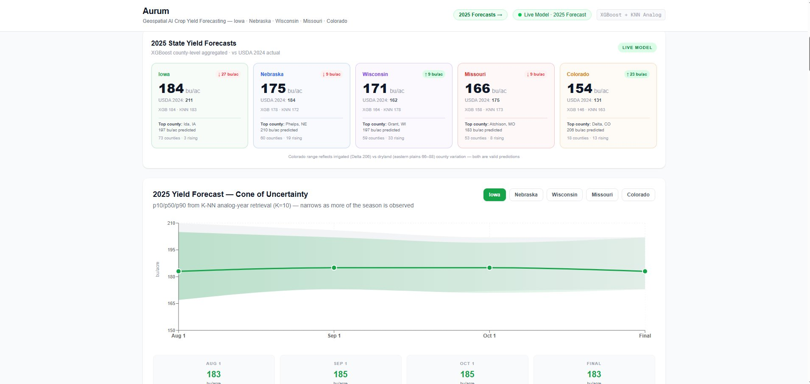
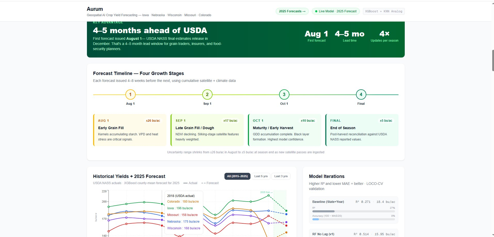
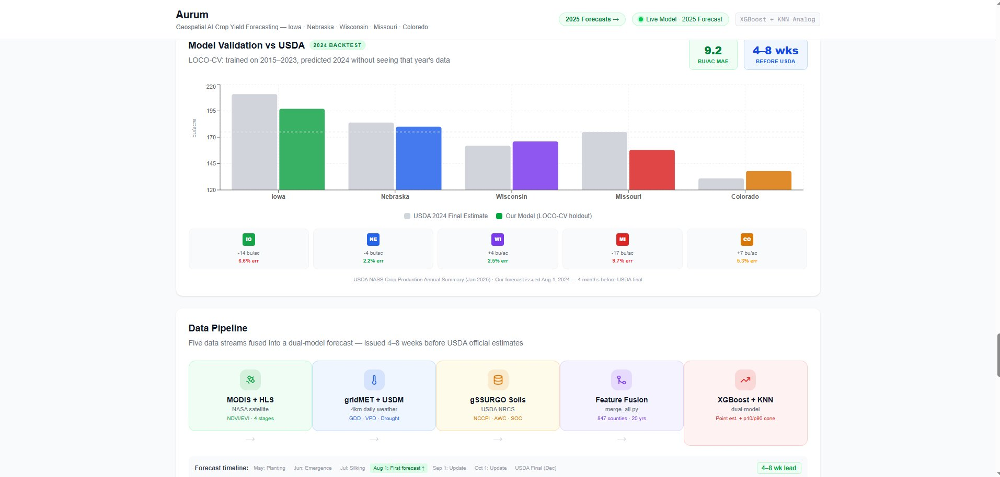
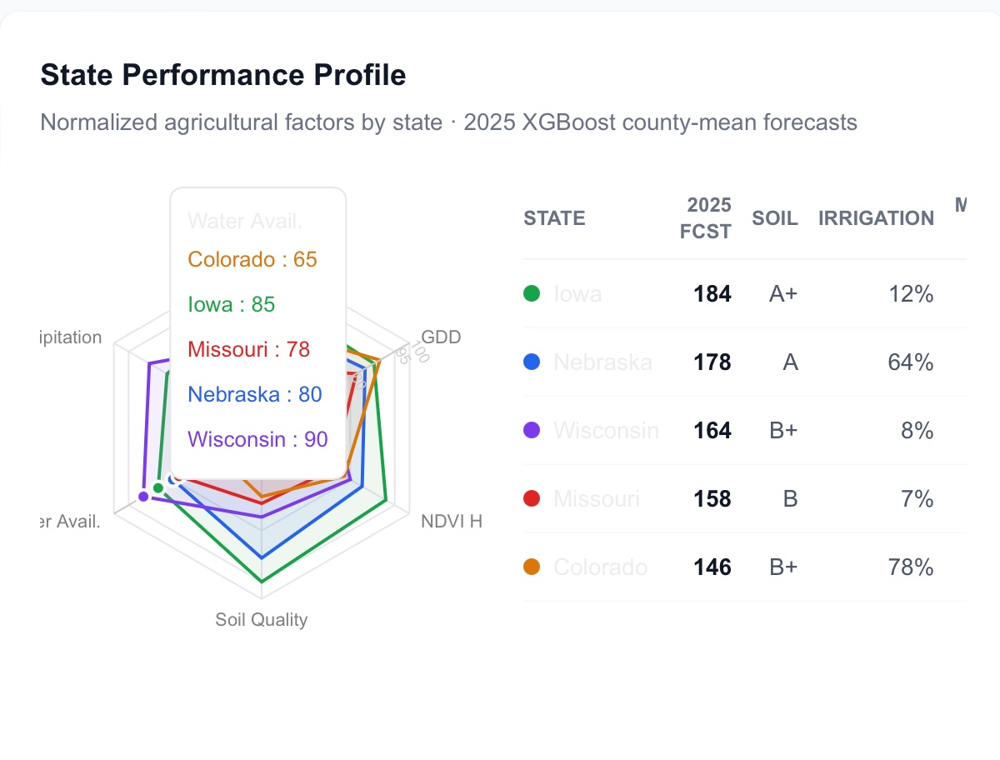

[README.md](https://github.com/user-attachments/files/33614967/README.md)

  

  <a href="LIVE_SITE_URL"><b>Live dashboard</b></a> &nbsp;·&nbsp;
  <a href="https://www.barrie.dev/">barrie.dev</a> &nbsp;·&nbsp;
  <a href="#how-it-works">How it works</a> &nbsp;·&nbsp;
  <a href="#results">Results</a>

Aurum forecasts corn yields for 263 counties across Iowa, Nebraska, Wisconsin, Missouri, and Colorado using NASA satellite imagery, climate, soil, and drought data. It issues its first forecast on August 1, four to five months before the USDA publishes its final numbers, and gives a range (p10 / p50 / p90) instead of a single guess.

It won the **NASA & USDA Land Use Challenge at CSU Hackathon 2026** (sponsored by AWS and Databricks). We built it as a team of 4 in 24 hours and were selected to present it to NASA and USDA stakeholders in Washington, D.C.

  

## How it works

**1. Data.** Five sources that were never meant to line up, joined at the county-year level into an AWS S3 data lake of 20,000+ records.

| Source | What it adds |
|---|---|
| NASA HLS (via Google Earth Engine) | NDVI and EVI vegetation indices across 4 corn growth stages |
| gridMET | Daily weather: growing degree days, vapor pressure deficit, heat stress |
| US Drought Monitor | Drought severity through the season |
| gSSURGO (USDA NRCS) | Soil productivity, water capacity, organic carbon |
| USDA NASS | Historical county yields (the target) |

**2. Model.** Two models working together:
- **XGBoost** produces the point forecast for each county.
- **KNN analog-year retrieval** finds the 10 past seasons that looked most like this one and uses how those years turned out to build the p10 / p50 / p90 range. The range tightens as more of the season is observed.

**3. Validation.** An early version scored 0.514 R², but only because it was seeing data that wouldn't exist yet on forecast day. We rebuilt validation with leave-one-county-out cross-validation and a strict as-of rule so every feature is gated to what's actually known on that date. The number got more honest, then got better.

  

## Results

| Model | R² | MAE (bu/ac) |
|---|---|---|
| Baseline (state + year) | 0.271 | 18.4 |
| **Aurum (XGBoost + KNN, leak-free)** | **0.789** | **9.2** |

2024 backtest: trained without ever seeing 2024, forecast issued August 1, then compared against the USDA's final estimate released the following January.

  

  

## Stack

`Python` `XGBoost` `scikit-learn` `Google Earth Engine` `AWS S3` `SageMaker` `Databricks` `Jupyter` `Next.js`

## Team

Built in 24 hours by a team of 4 at CSU Hackathon 2026. I ([@Yumstezy](https://github.com/Yumstezy)) owned the data layer, model training, and the dashboard.
